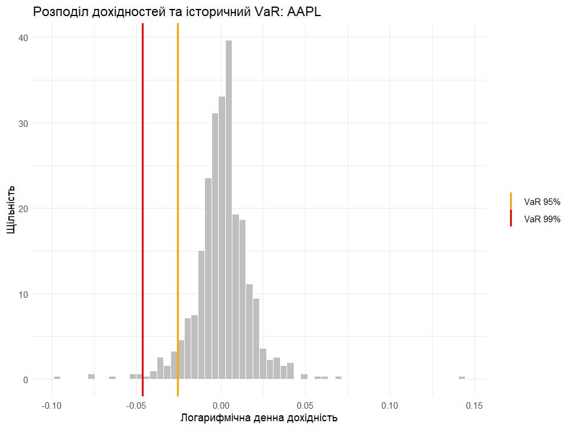

# risk-management-hw1

Практичне заняття №2: розрахунок Value at Risk та Expected Shortfall в R.

scripts/main_analysis.R - скрипт аналізу
data/ - графіки та результати

Apple (AAPL) та S&P 500 (^GSPC). Щоденні ціни Yahoo Finance за останні 3 роки, логарифмічні дохідності, по 751 спостереженню. VaR рахувався історичним і параметричним методами, ES - історичним (95%).

## Результати

| Актив | Hist VaR 95% | Hist VaR 99% | Param VaR 95% | Param VaR 99% | ES 95% |
|---|---|---|---|---|---|
| AAPL | -2.55% | -4.63% | -2.68% | -3.83% | -3.91% |
| ^GSPC | -1.47% | -2.53% | -1.47% | -2.11% | -2.14% |

## Висновки

Apple ризикованіша за S&P 500: її VaR приблизно в 1,7-1,8 раза більший на обох рівнях довіри. На рівні 95% обидва методи дають близькі значення, а на 99% історичний VaR більший (для AAPL -4,63% проти -3,83%). Тобто реальний розподіл має товсті хвости, а нормальний їх недооцінює. ES показує середній збиток у найгірших 5% днів, тому він більший за VaR 95% (для AAPL -3,91% проти -2,55%).
